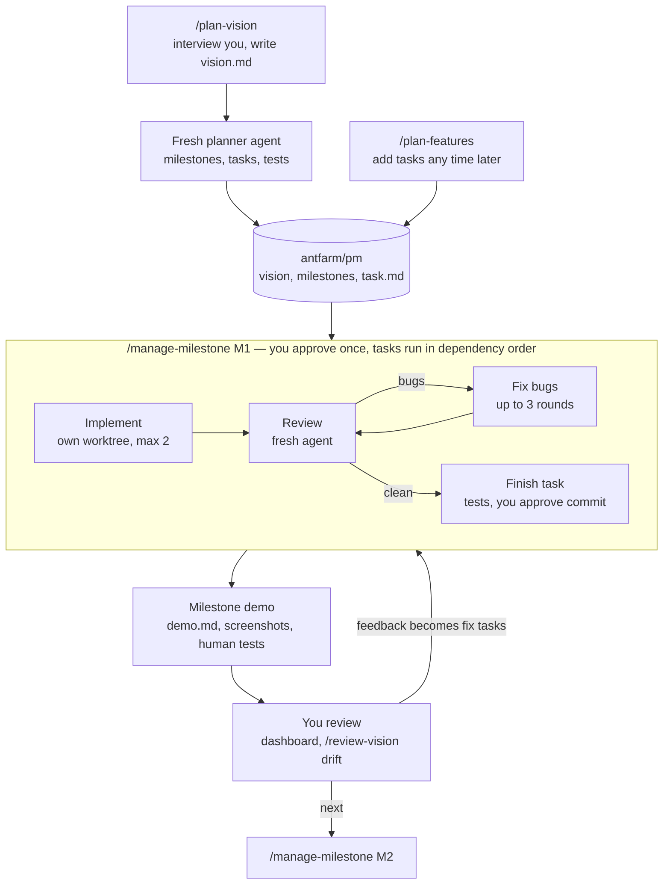

# 🐜 antfarm

Drop an ant farm into any project and watch the colony work: a Claude Code workflow where agents turn **idea → vision → milestones → tasks**, with you approving each milestone once, and every commit and push.

Needs [git](https://git-scm.com/downloads), Python 3 and [Claude Code](https://claude.com/claude-code).

## How it works



1. **`/plan-vision`** interviews you and challenges the idea, then a fresh planner splits the approved vision into milestones and small tasks. M1 is the smallest working slice.
2. **`/manage-milestone M<n>`** asks you once for the whole milestone, then runs each task through implement → fresh review → fix until clean. Commits still need your yes. It ends with a demo for you to review.
3. **`/plan-features <idea>`** adds new tasks to the plan whenever you think of something, flagging anything that conflicts with the vision.

## Install with Claude

Open Claude Code in your project and paste the prompt for your system.

**Windows (PowerShell or cmd):**

```text
Install antfarm into this project, using PowerShell (not bash):
1. If $HOME\antfarm doesn't exist, run `git clone https://github.com/J0nti/antfarm.git $HOME\antfarm`; otherwise run `git -C $HOME\antfarm pull --ff-only`.
2. Run `python $HOME\antfarm\antfarm\antfarm.py install`.
3. Run `python $HOME\antfarm\antfarm\antfarm.py add .` (the project root).
4. Follow the steps in `antfarm/skills/init-antfarm/SKILL.md` for this project, using the PowerShell commands where it gives them. Ask me before overwriting anything or running git init.
5. Tell me what changed, and that I should restart Claude Code and then run /plan-vision.
```

**macOS / Linux:**

```text
Install antfarm into this project:
1. If ~/antfarm doesn't exist, run `git clone https://github.com/J0nti/antfarm.git ~/antfarm`; otherwise run `git -C ~/antfarm pull --ff-only`.
2. Run `bash ~/antfarm/antfarm/install.sh`.
3. Run `bash ~/antfarm/antfarm/add-to-project.sh .` (the project root).
4. Follow the steps in `antfarm/skills/init-antfarm/SKILL.md` for this project. Ask me before overwriting anything or running git init.
5. Tell me what changed, and that I should restart Claude Code and then run /plan-vision.
```

To update later, paste:

```text
Update antfarm in this project: run `python antfarm/antfarm.py update` (or `bash antfarm/update.sh` on macOS/Linux), then follow `antfarm/skills/init-antfarm/SKILL.md` as an upgrade. Ask me before overwriting anything, then tell me what changed.
```

## Install by hand on Windows

In PowerShell or cmd, no bash needed. Use `py` instead of `python` if that's what your Python install gives you. In cmd, write `%USERPROFILE%` instead of `$HOME`.

1. Clone the template once, somewhere permanent. The skill links to this folder, so don't delete or move it.
   ```powershell
   git clone https://github.com/J0nti/antfarm.git $HOME\antfarm
   ```
2. Make `/init-antfarm` available in every project. The skill is linked with a directory junction, so you don't need admin rights or Developer Mode.
   ```powershell
   python $HOME\antfarm\antfarm\antfarm.py install
   ```
3. Copy antfarm into a project, or update an existing copy. Data in `antfarm\pm\` is never touched.
   ```powershell
   python $HOME\antfarm\antfarm\antfarm.py add C:\path\to\my-project
   ```
4. Open Claude Code in the project and run `/init-antfarm`, then `/plan-vision` for a new project. For a project you've already started, run `/adopt-antfarm` instead: it surveys the code, writes the architecture and conventions, records what already works as done tasks (milestone M0), turns TODOs and known issues into a backlog you go through, then plans what's next.
5. Later, from inside the project, pull the latest template and sync it in, then run `/init-antfarm` again:
   ```powershell
   python antfarm\antfarm.py update
   ```

Dashboard: double-click `antfarm\dashboard.cmd` in Explorer (close the window to stop it), or run `python antfarm\dashboard.py` (add `--tui` for the terminal version).

## Install by hand on macOS / Linux

```bash
git clone https://github.com/J0nti/antfarm.git ~/antfarm
bash ~/antfarm/antfarm/add-to-project.sh ~/my-project   # then /init-antfarm in that project
bash antfarm/update.sh                                   # later, inside a project: pull latest + sync
```

The template lives in [`antfarm/`](antfarm/): start with [antfarm/README.md](antfarm/README.md).
