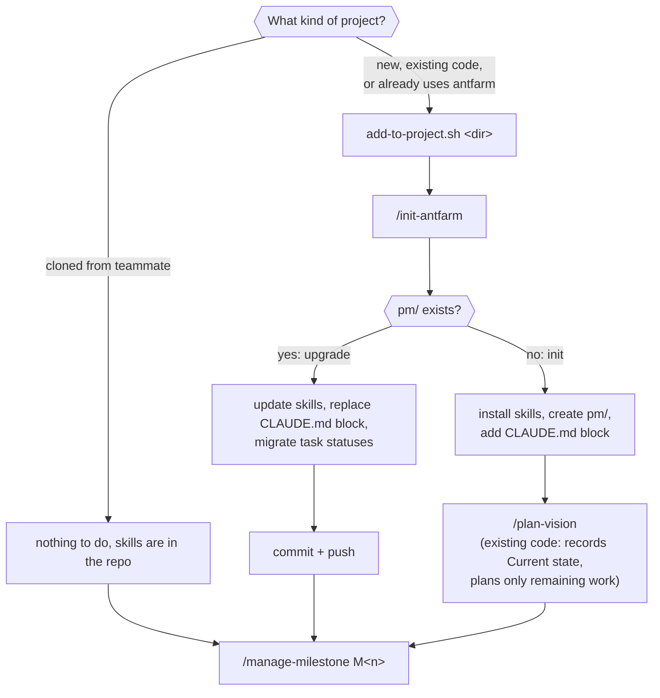
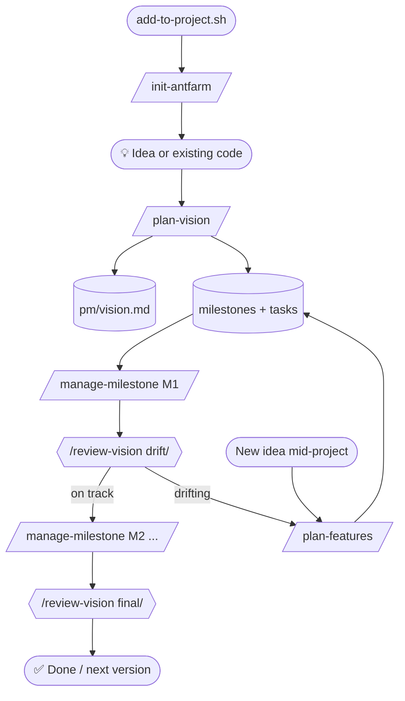
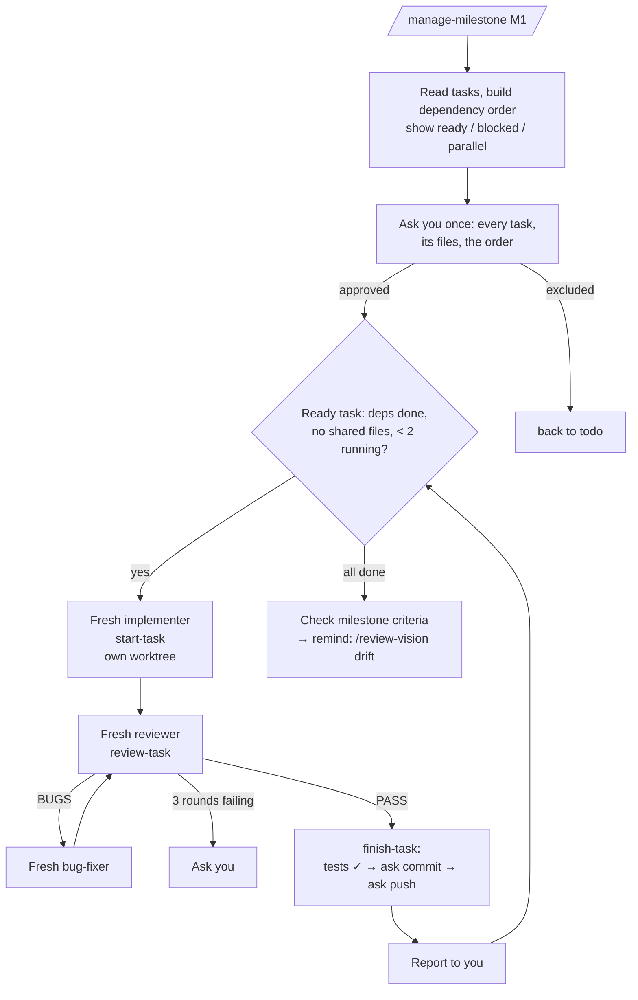
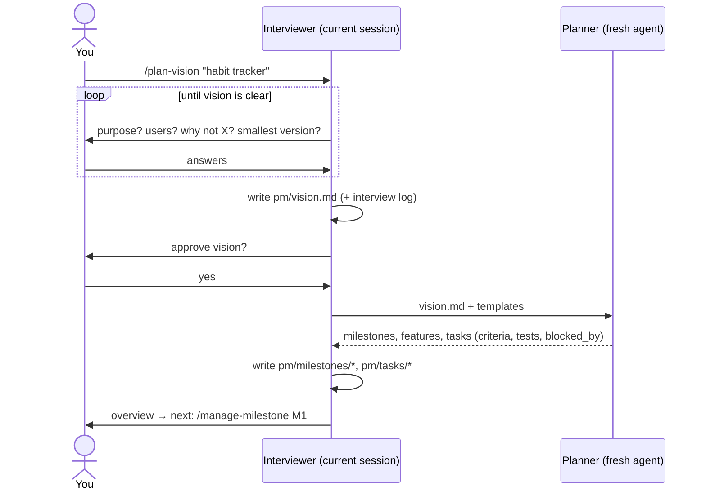
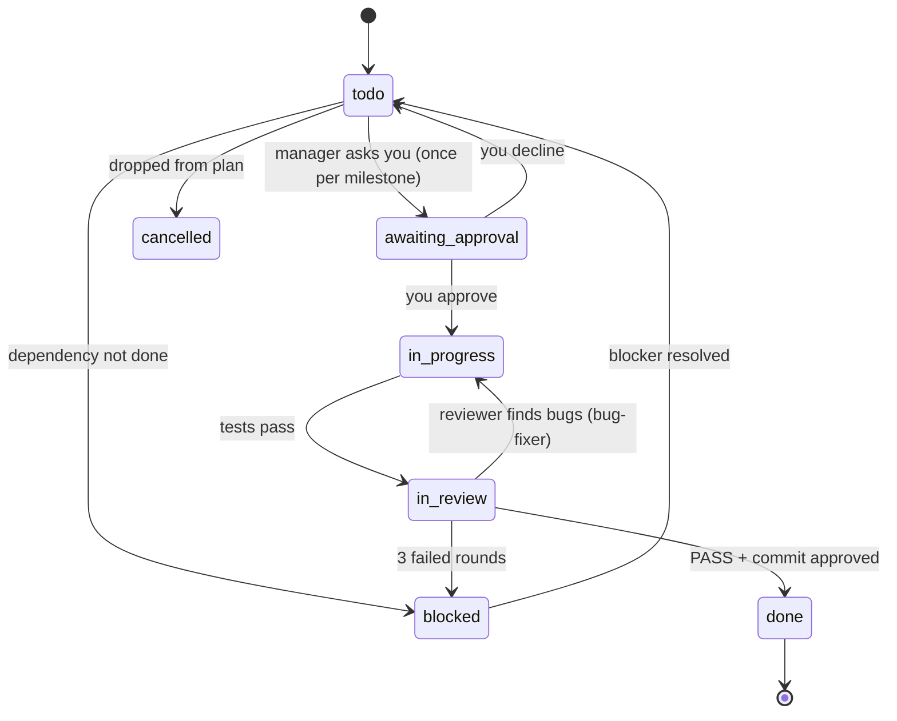
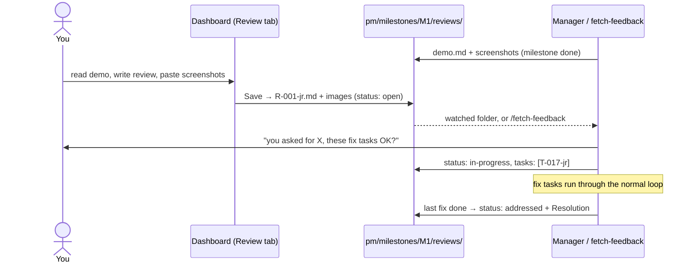
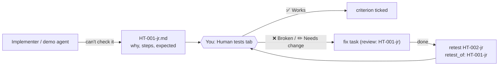
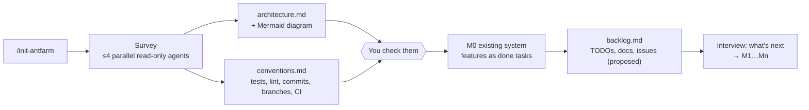
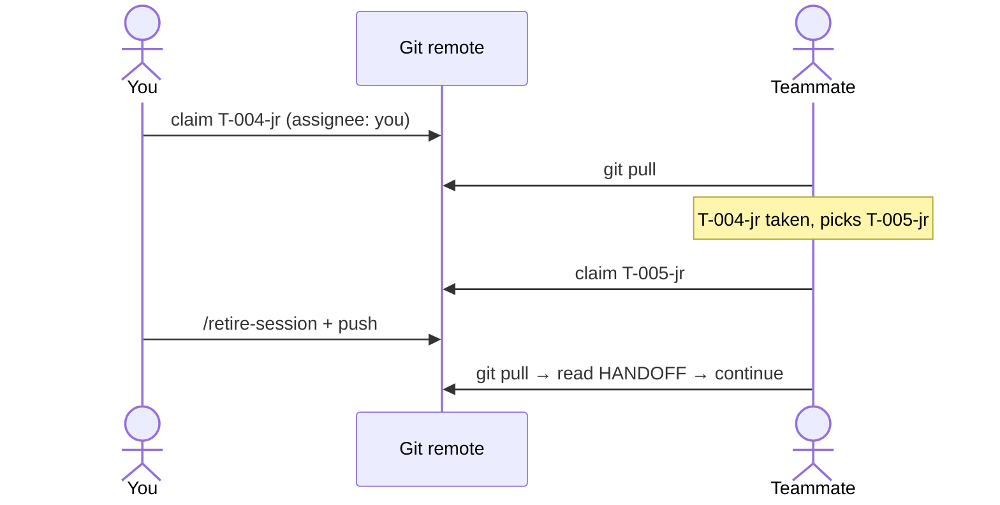
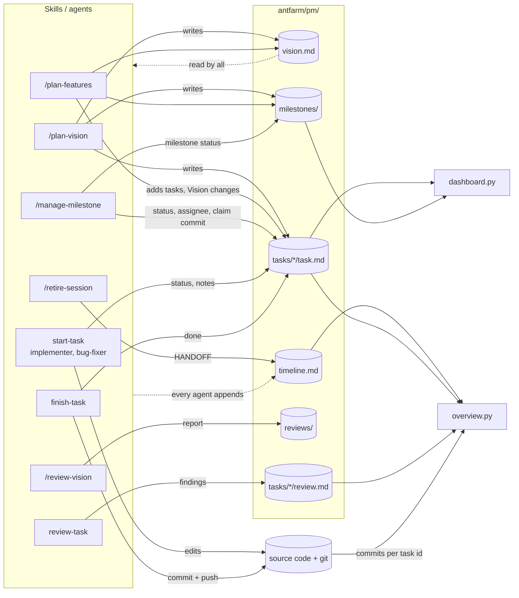

# antfarm — details

Reference for everything not in the [README](README.md).

## Setup and updating

```bash
bash /path/to/antfarm/add-to-project.sh ~/my-project   # copies antfarm/ in, or updates it; never touches pm/
cd ~/my-project && claude
> /init-antfarm     # new: sets up · existing pm/: upgrade (skills, CLAUDE.md block, task statuses) · old ai-workflow/: migrates
```
The script also runs `install.sh` if `/init-antfarm` isn't installed yet.

**Update a project** (from inside it): `bash antfarm/update.sh` pulls the latest template from git (it finds your clone through the `/init-antfarm` link), syncs it into the project, then run `/init-antfarm`.
Then commit and push. Teammates only need `git pull` (and a session restart if skills changed).

### Which setup path?



## Full flow



## /manage-milestone — the manager loop



Approval gates: **once per milestone** for starting its tasks (again only for tasks added later), and every time **before `git commit`** and **before `git push`**. Every commit ends with `Agent:` / `Model:` lines, enforced by `antfarm/git-hooks/commit-msg` (`/init-antfarm` turns it on with `git config core.hooksPath antfarm/git-hooks`; each clone runs that once).
A task is `done` only when its acceptance criteria and tests pass.

## /plan-vision



## Tasks

### Task lifecycle



### Task statuses
| Status | Meaning |
|---|---|
| `todo` | planned, not started |
| `awaiting-approval` | manager asked you, waiting for your yes |
| `in-progress` | implementer or bug-fixer working |
| `blocked` | dependency not done or review loop failed 3× (`blocked_reason`) |
| `in-review` | fresh reviewer checking |
| `done` | criteria + tests pass, committed |
| `cancelled` | dropped from the plan, kept for history, excluded from % |

### Dashboard output

Shows % done for the whole project and per milestone (done tasks / all non-cancelled tasks), plus every task's status.
Python 3 stdlib only, nothing to install. Reads `task.md` frontmatter, so it is always in sync with what agents write.

```
PROJECT  ███████████████░░░░░░░░░░░░░░░  50%
  todo: 0  in-progress: 0  blocked: 1  in-review: 0  done: 1

M1: Core  ███████████████░░░░░░░░░░░░░░░  50%
  T-001-jr   done        Model
  T-002-jr   blocked     API  (T-009-jr)
```

## Milestone reviews



- `python3 antfarm/dashboard.py` runs a small server on `127.0.0.1` (port 8737 or the next free one) so the Review and Human tests tabs can save. It watches `pm/` and the project docs (inotify on Linux, a 2 s file check elsewhere) and pushes changes to the page over a WebSocket: no polling, no page reloads. The Tasks view and numbers update in place; on Docs, Review and Human tests a "Refresh view" note appears so nothing you are typing is replaced. Only local, same-origin requests are accepted. `--static` writes a read-only `pm/dashboard.html` like before.
- Review statuses: `open` → `in-progress` (fix tasks created) → `addressed` (all fix tasks done), or `closed` (approve / comment without work).
- The text draft is kept in your browser until you save; pasted images are not, so add them right before saving.

## Human tests



- Files: `antfarm/pm/milestones/<M>/human-tests/HT-<nnn>-<initials>.md` (template: `antfarm/templates/human-test.md`). Results are appended as `## Result <n>` with screenshots next to the file.
- Statuses: `pending` → `pass` | `broken` | `needs-change`; `handled: false` until `/fetch-feedback` has acted on the latest result.
- A task can be done with a human test pending; the milestone waits in `in-review` until its human tests pass.
- Criteria only a human can check are marked `(human)` and are never ticked by an agent.

## Adopting an existing project



- `/adopt-antfarm` only reads your code; it writes under `antfarm/pm/`.
- `conventions.md` wins over antfarm's defaults: agents use your test/lint commands, commit format (with the task id added) and branch naming, and leave "must not change" areas alone.
- M0 makes the dashboard start from reality: existing features show as done, and `/review-vision drift` has a baseline.
- Monorepo: `/adopt-antfarm services/api` plans only that part.
- Backlog items are proposals; nothing becomes a task until you accept it. Issues from GitLab/GitHub are read only if `glab`/`gh` is set up and you agree.

## Working as a team

Everything is in the repo (`.claude/skills/`, `CLAUDE.md`, `antfarm/pm/`), so a teammate just clones and runs `claude`, no install or init needed.

- **Task IDs** include the creator's initials: `T-015-jr`, so parallel planning never collides.
- **Claiming:** when an approved task starts, the manager sets `assignee` and immediately commits + pushes `claim T-015-jr`. Others `git pull` first and skip tasks assigned to someone else. A rejected push means re-pull and re-check.
- **Handing over:** run `/retire-session` and push before someone else continues; worktrees and uncommitted work stay on your machine.
- **Timeline conflicts:** append-only, keep both sides' lines.
- **Several sessions on one machine:** a session started with `/start-task` renames itself after its task. Sessions ask each other with `ListAgents` + `SendMessage` (about files, decisions, status) instead of going through you, and `finish-task` tells the sessions that depend on the finished task. Desktop app only; the CLI skips this.
- `pm/dashboard.html` and `pm/overview.html` are gitignored (via `antfarm/.gitignore`); everyone generates their own. The dashboard shows local files, so `git pull` to see teammates' progress.



## Internal task management (`antfarm/pm/`)

### Who reads and writes what



Solid arrows are writes. All agents read `vision.md` and append to `timeline.md`. `dashboard.py` and `overview.py` only read.

```
antfarm/pm/
├── vision.md                      # purpose, users, non-goals, success criteria, interview log
├── timeline.md                    # append-only log, every agent writes here
├── dashboard.html                 # generated by dashboard.py
├── milestones/
│   └── M1-core-tracking.md        # features, task table, milestone criteria
├── tasks/
│   └── T-001-jr-data-model/
│       ├── task.md                # status, blocked_by, files, criteria, tests
│       └── review.md              # review rounds + bug fixes
└── reviews/
    └── 2026-10-20-drift.md        # /review-vision reports
```

Timeline example:

```
- 2026-10-09 10:02 | interviewer     | -     | - | vision.md approved
- 2026-10-09 10:15 | planner         | -     | - | created M1–M3, T-001-jr..T-014-jr
- 2026-10-09 10:30 | manager         | T-001-jr | M1-20261009-1030-jr | milestone approved by user, started (worktree wt-T-001-jr)
- 2026-10-09 10:52 | implementer     | T-001-jr | M1-20261009-1030-jr | data model + 6 tests passing
- 2026-10-09 10:58 | reviewer        | T-001-jr | M1-20261009-1030-jr | round 1: BUGS (missing unique constraint)
- 2026-10-09 11:05 | bug-fixer       | T-001-jr | M1-20261009-1030-jr | added constraint + test
- 2026-10-09 11:09 | reviewer        | T-001-jr | M1-20261009-1030-jr | round 2: PASS
- 2026-10-09 11:12 | finisher        | T-001-jr | M1-20261009-1030-jr | committed a1b2c3d, pushed
- 2026-10-09 17:40 | session         | -     | - | HANDOFF: done=T-001-jr..T-003-jr; next=/manage-milestone M1
```

## Examples

**New project from scratch**
```
> /init-antfarm
> /plan-vision a CLI that tracks daily habits and shows streaks
  ...interview: who uses it? why not a spreadsheet? offline? ...
> /manage-milestone M1
  Manager: T-001-jr and T-004-jr are ready, T-002-jr blocked by T-001-jr.
           Start T-001-jr (src/db.py, tests/test_db.py) — blocks T-002-jr, T-003-jr. OK?
> yes
  ...implement → review → fix → review PASS... Commit "T-001-jr: data model"? → yes. Push? → yes
> /review-vision drift
> /manage-milestone M2
```

**Existing project**
```
> /init-antfarm
> /plan-vision            # reads the existing code first, then interviews you about where it should go
```

**New feature mid-project**
```
> /plan-features export streaks to CSV
  → added T-015-jr, T-016-jr to M2 (T-016-jr blocked by T-015-jr)
```

**Run a single task by hand** (no manager)
```
> /start-task T-007-jr
> /review-task T-007-jr
> /finish-task T-007-jr
```

**End of day / resume tomorrow**
```
> /retire-session         # writes HANDOFF
  ...new session...
> read the last HANDOFF in antfarm/pm/timeline.md and continue
```

**Finish the project**
```
> /review-vision final    # success criteria pass/fail + what changed since the first interview
```
