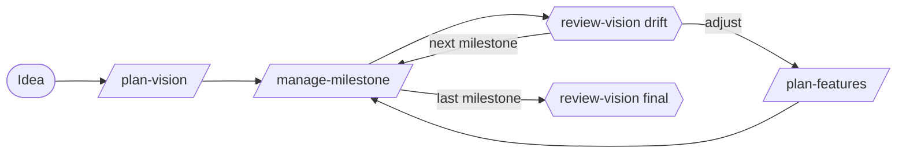
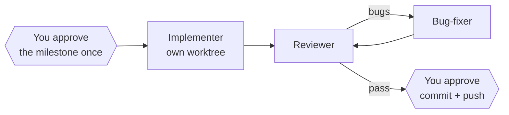

# 🐜 antfarm

Drop an ant farm into any project and watch the colony work: a Claude Code workflow where agents turn **idea → vision → milestones → tasks**, built, reviewed and fixed, with you approving each milestone once, and every commit and push.

## Quick start

```bash
bash antfarm/add-to-project.sh ~/my-project   # copy in, or update an existing copy
cd ~/my-project && claude
> /init-antfarm
> /plan-vision                  # interview → vision → milestones + tasks
> /manage-milestone M1          # agents build it, you approve
```

Project that already has code? Run `/adopt-antfarm` instead of `/plan-vision`.

**Windows (cmd or PowerShell, no bash):** `antfarm.py` does the same as the three `.sh` scripts:

```text
python antfarm\antfarm.py install                 # once per machine (install.sh)
python antfarm\antfarm.py add C:\path\to\project  # copy in or update (add-to-project.sh)
python antfarm\antfarm.py update                  # from inside the project (update.sh)
```

The skill is linked with a directory junction, so you don't need admin rights or Developer Mode. Use `python` (or `py`) wherever these docs say `python3`.

Update later, from inside the project: `bash antfarm/update.sh` (Windows: `python antfarm\antfarm.py update`), then `/init-antfarm`.

## Install with Claude

Paste-in install and update prompts for Windows and macOS/Linux are in the repo README: https://github.com/J0nti/antfarm#install-with-claude

## The flow



## Inside a milestone



The manager runs up to 2 tasks at a time, in dependency order, each in its own git worktree, and never two that touch the same files. Every agent is fresh and writes to the timeline. Other Claude sessions on your machine working on other tasks ask each other directly (`ListAgents` / `SendMessage`) instead of going through you.

## Skills

| Command | What it does |
|---|---|
| `/init-antfarm` | Set up or upgrade the workflow in this project |
| `/plan-vision` | Interview you, write the vision, plan milestones and tasks |
| `/adopt-antfarm [path]` | Existing codebase: survey it, write architecture + conventions, mark what exists as done (M0), import the backlog, then plan what's next |
| `/manage-milestone M1` | Build a milestone with agents |
| `/review-vision drift` | After each milestone: still on track? |
| `/review-vision final` | End review against the first interview |
| `/plan-features <idea>` | Add new tasks to the plan |
| `/fetch-feedback [M1]` | Turn your dashboard reviews and human test results into fix tasks (`/fetch-reviews` works too) |
| `/retire-session` | Save a handoff so the next session can resume |
| `/start-task` · `/review-task` · `/finish-task` | Single steps, used by the manager or by hand |

## See progress

| Command | Shows |
|---|---|
| `python3 antfarm/dashboard.py` | Live dashboard on localhost (changes pushed over a WebSocket): Tasks, Docs, Review, Human tests and Settings tabs |
| `antfarm\dashboard.cmd` (Windows) | Double-click it in Explorer: starts the same dashboard and opens it; close the window to stop |
| `python3 antfarm/dashboard.py --tui` | Same, in the terminal |
| `python3 antfarm/overview.py` | Manager runs, agents, bugs, code diffs, timeline |
| `python3 antfarm/view.py [file.md]` | Any Markdown file with diagrams drawn |

## Review a milestone

When a milestone is done, the manager writes a demo with screenshots and a flow diagram. Open the dashboard's **Review** tab, read the demo, and **approve**, **comment** or **request changes**; paste screenshots straight into the text. Save writes it to `antfarm/pm/milestones/M1/reviews/`. A running `/manage-milestone` picks it up, or run `/fetch-feedback`: change requests become new tasks in that milestone.

## Human tests

When an agent can't check something itself (a real login, hardware, a phone, how it looks), it writes a human test instead of pretending: why, exact steps, expected result. They show up as 🧪 in the dashboard's **Human tests** tab. Follow the steps and click **Works**, **Broken** or **Needs change**, with notes and screenshots. Works ticks the criterion; Broken / Needs change becomes a fix task, followed by a retest. A milestone is only done when its human tests pass.

## Rules

- You approve each milestone's task list once (`/manage-milestone`), or each task you start by hand. Every commit and push is still asked.
- Every commit ends with `Agent:` and `Model:` lines naming who did the work (`antfarm/git-hooks/commit-msg` enforces it), so you can compare models later: `git log --format="%h %s | %(trailers:key=Model,valueonly)"`.
- A task is done only when its tests pass.
- Everything is logged in `antfarm/pm/timeline.md`.

More: [DETAILS.md](DETAILS.md) covers updating, task statuses, team use, the `pm/` folder and examples.
