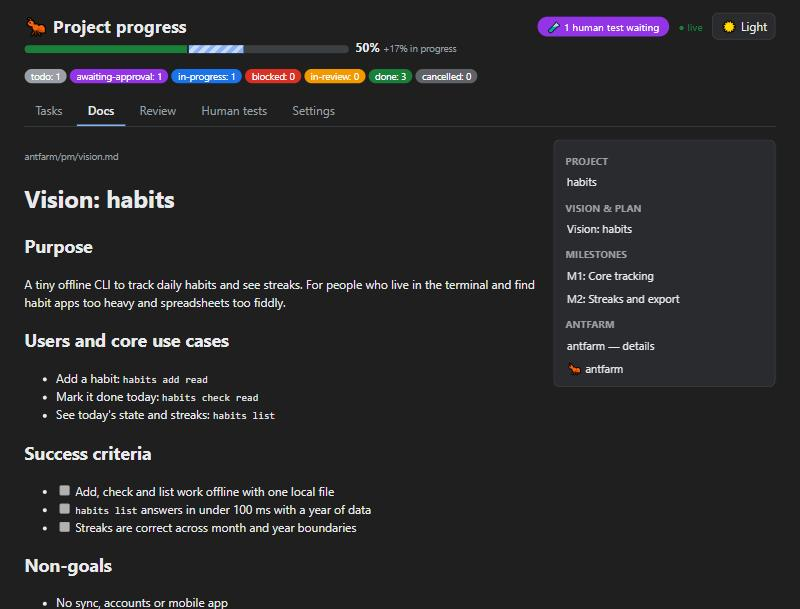
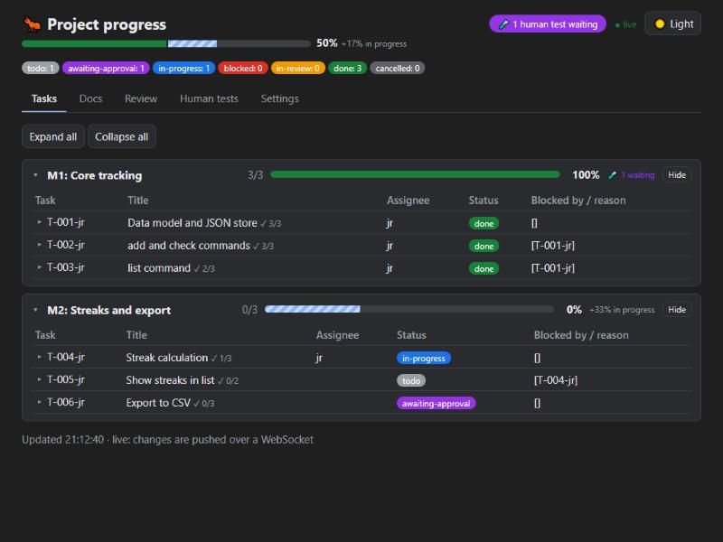
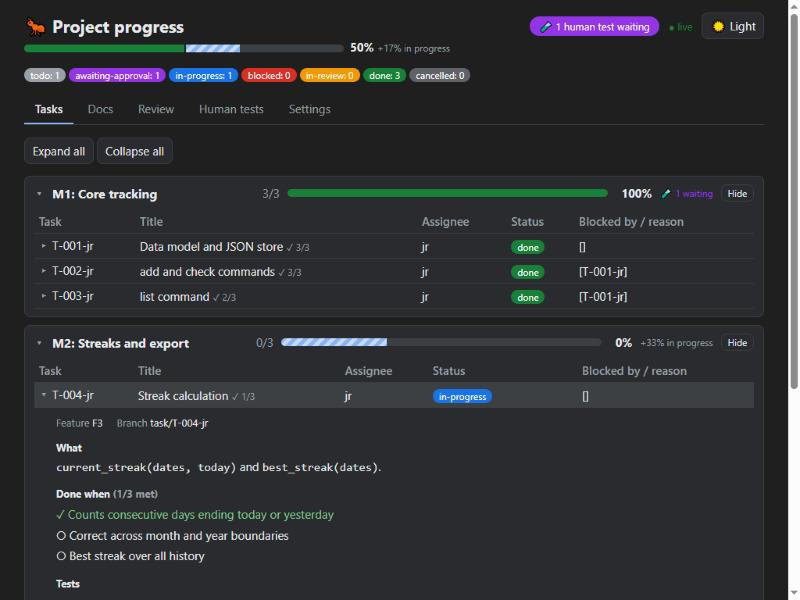
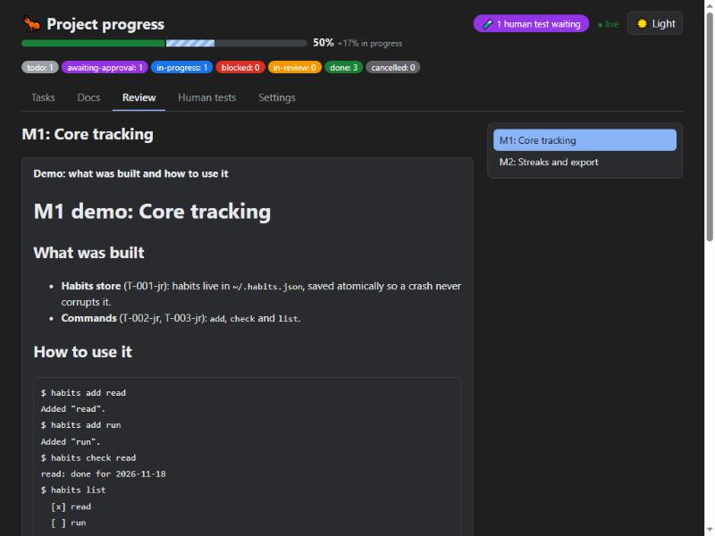
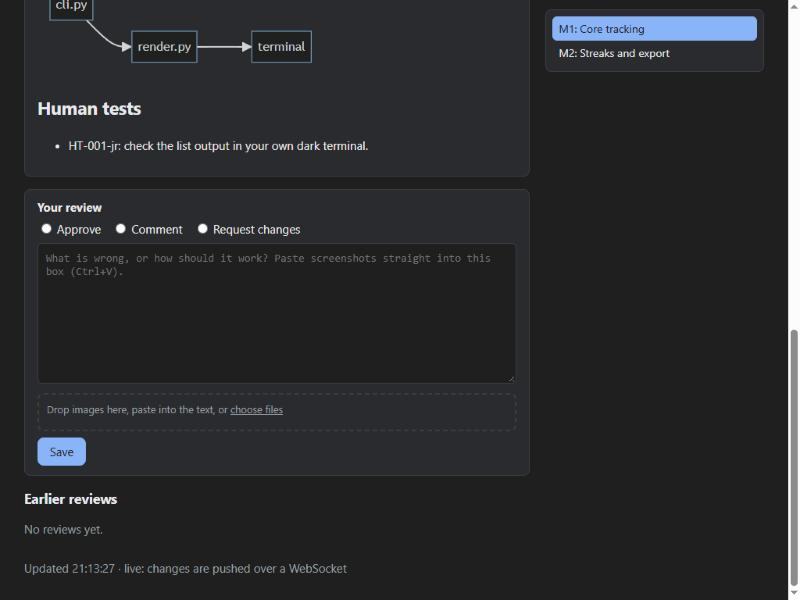
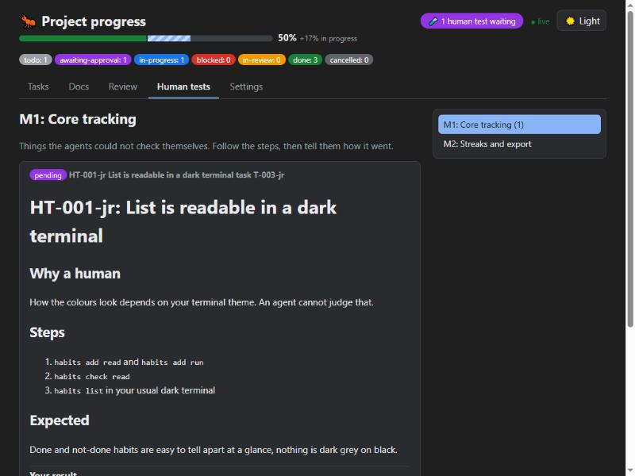

# Example: a whole flow, start to finish

This walks through building **habits**, a tiny offline CLI that tracks daily habits and shows streaks, using every antfarm command once. The conversations are shortened; the dashboard screenshots are real, taken from the sample project at the end of the walkthrough.

## 1. Set up: `/init-antfarm`

After installing (see [README](README.md#install-with-claude)), open Claude Code in the empty project:

```text
> /init-antfarm
  Installed 12 skills into .claude/skills, created antfarm/pm/, added the workflow rules to CLAUDE.md.
  Next: /plan-vision
```

For a project that already has code, run `/adopt-antfarm` instead. It surveys the code, writes `architecture.md` and `conventions.md`, records what already works as done tasks in milestone M0, and then plans what's next.

## 2. Plan: `/plan-vision`

```text
> /plan-vision a CLI that tracks daily habits and shows streaks
  Who is it for, and why not just use a spreadsheet?
> me. I forget to open spreadsheets, but I always have a terminal open.
  What is the riskiest assumption?
> that a streak keeps me motivated
  Then M1 should be usable every day without streaks, so you find out fast. Offline only? Sync?
> offline, one local file, standard library only
  ...
  Here's the vision summary. Approve?
> yes
  Planner: M1 Core tracking (3 tasks), M2 Streaks (2 tasks).
  Next: /manage-milestone M1
```

You now have `antfarm/pm/vision.md`, one file per milestone, and one `task.md` per task, each with acceptance criteria, test commands and the files it expects to touch. The **Docs** tab of the dashboard shows them all:



## 3. Build: `/manage-milestone M1`

```text
> /manage-milestone M1
  Plan for M1:
    1. T-001-jr Data model and JSON store   habits/store.py, tests/test_store.py
    2. T-002-jr add and check commands       waits on T-001-jr
    3. T-003-jr list command                 waits on T-001-jr, runs in parallel with T-002-jr
  Approving lets me claim and start each task. Commits and pushes are still asked. OK?
> yes
  T-001-jr: implementer done, 5 tests passing
  T-001-jr: reviewer round 1: BUGS (duplicate habit names accepted)
  T-001-jr: bug-fixer added a check + test; reviewer round 2: PASS
  Commit "T-001-jr: data model and JSON store"? → yes. Push? → yes
  Starting T-002-jr and T-003-jr in their own worktrees...
```

Run the dashboard while this happens and the **Tasks** tab updates live as agents claim and finish tasks:

```powershell
python antfarm\dashboard.py
```



Click a task to see its criteria, tests, review rounds and notes:



When every task is done, a demo agent writes `demo.md` with what was built, how to use it and a flow diagram. Anything it couldn't check itself becomes a human test, so M1 waits in `in-review`.

## 4. Review: dashboard + `/fetch-feedback`

Open the **Review** tab and read the demo:



At the bottom, approve, comment or request changes. You can paste screenshots straight into the text box:



The **Human tests** tab lists what only you can check. Here: does the list look right in your own dark terminal? Follow the steps and click Works, Broken or Needs change.



A running `/manage-milestone` picks up your answers. Otherwise run:

```text
> /fetch-feedback M1
  HT-001-jr: Needs change ("done items are dark grey, hard to see") → created T-007-jr Brighter done colour in M1
```

Run `/manage-milestone M1` again to fix it. Once your review and human tests pass, M1 is `done`.

## 5. Check direction: `/review-vision drift`

```text
> /review-vision drift
  On track: M1 delivers add/check/list offline. No non-goals touched.
  Watch: list speed with a year of data isn't measured yet. Suggest a criterion in M2.
```

## 6. Add an idea: `/plan-features`

```text
> /plan-features export my history to CSV
  Fits the vision (your data stays local). Proposed for M2:
    T-006-jr Export to CSV   habits/export.py, habits/cli.py, tests/test_export.py
  Write it?
> yes
  Commit and push the new task so others see it? → yes
```

The new task shows up in M2 as `awaiting-approval` until the next `/manage-milestone M2` asks you.

## 7. Next milestone, and stopping for the day

```text
> /manage-milestone M2
  ...
> /retire-session
  HANDOFF written to antfarm/pm/timeline.md: done=T-004-jr; next=T-005-jr, T-006-jr
```

Tomorrow, a new session reads the last HANDOFF and carries on. When the last milestone is done, `/review-vision final` checks the result against your first interview.

## Single steps by hand

The manager uses these internally, but you can run them yourself for one task:

```text
> /start-task T-005-jr    # implement until criteria and tests pass
> /review-task T-005-jr   # fresh-eyes review into review.md
> /finish-task T-005-jr   # verify, then commit and push with your yes
```
